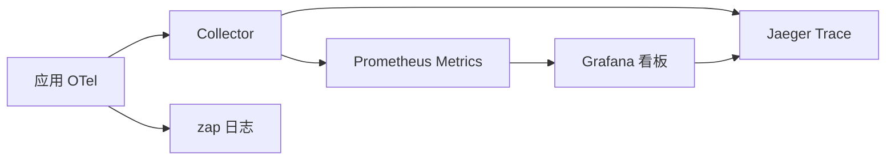

# 可观测性

OpenTelemetry统一生成调用链和独立指标；zap日志按Trace关联。Collector将Trace发往Jaeger，将Metrics提供给Prometheus保存历史，Grafana展示看板与告警。系统诊断保留即时快照；模型用量与质量评测继续使用业务记录。



| 任务 | 入口 |
| --- | --- |
| 启用本地观测栈 | [启动与配置](#启动与配置) |
| 按追踪编号排障 | [查找一次请求](#查找一次请求) |
| 指标与告警口径 | [历史指标、看板与告警](#历史指标看板与告警) |
| 验证与证据 | [本页验证](#验证)、[历史记录](14-verification.md#已有证据索引) |

## 启动与配置

从仓库根目录的PowerShell执行：

```powershell
docker compose -f deploy/docker-compose.yml --profile observability up -d grafana
```

该命令通过依赖启动Grafana、Prometheus、Collector和Jaeger，不启动业务后端或数据库。宿主机端口只绑定回环地址；默认启动PostgreSQL/Redis不会隐式启动该profile。

| 入口 | 地址 |
| --- | --- |
| Grafana只读看板 | `http://127.0.0.1:3000/d/rag-observability` |
| Prometheus告警状态 | `http://127.0.0.1:9090/alerts` |
| Jaeger查询 | `http://127.0.0.1:16686` |
| Collector OTLP/HTTP | `http://127.0.0.1:4318/v1/traces`、`/v1/metrics` |

按 [部署运维](13-deployment.md#7-数据库初始化和升级) 先完成至049的迁移；以下示例从仓库根目录设置当前后端进程，不会执行迁移：

```powershell
$env:OTEL_SERVICE_NAME='rag-backend'
$env:OTEL_EXPORTER_OTLP_TRACES_ENDPOINT='http://127.0.0.1:4318/v1/traces'
$env:OTEL_EXPORTER_OTLP_METRICS_ENDPOINT='http://127.0.0.1:4318/v1/metrics'
Set-Location backend
go run ./cmd/server
```

`OTEL_SERVICE_NAME`默认`rag-backend`。两个导出端点独立可选、默认空，必须是完整HTTP(S)地址；空Trace端点仍保留本地Trace ID/日志关联，空Metrics端点不周期采集/导出指标。协议为OTLP/HTTP protobuf。Collector的4318转发Trace到内部Jaeger并接收Metrics，Jaeger内部OTLP端口不映射到宿主机。

本地profile采用固定版本Jaeger 2.23.0、Collector 0.165.0、Prometheus 3.16.0、Grafana 13.3.0。Grafana为匿名Viewer且不创建初始管理员/显示登录表单，仅供本地开发；生产按实际身份与网络边界部署。

## 观测内容

| 层次 | 主要 span / 信息 |
|------|------------------|
| HTTP | Gin 路由模板、状态、请求耗时、最终 `app.outcome`、错误码 |
| 问答 | `rag.answer`、`rag.intent`、`rag.prompt`、意图、回答状态、引用数量 |
| 检索 | `rag.retrieval`、`rag.query_embedding`、`rag.vector_recall`、`rag.keyword_recall`、缓存结果、候选/上下文片段数量、精确召回回退、Rerank 降级 |
| 模型 | `model.chat`、`model.chat_stream`、`model.embedding`、`model.rerank`、`model.title`；配置的模型名与调用结果 |
| 依赖 | 模型 HTTP 调用、GORM 数据库操作、Redis 操作；不导出 SQL 文本和 Redis 命令参数 |
| 入库 | `document.process`、`document.storage_read`、`document.parse`、`document.ocr_page`、`document.chunk`、`document.publish`；任务/文档 ID、执行次数、切片数 |
| 持久化 | `chat.persist` 与 GORM 操作，可区分生成成功后保存消息失败 |

文档 worker 从数据库恢复入队父上下文；每次执行创建独立 span，重试作为上传 Trace 下的另一次执行。任务取消与失败分别标记。旧任务没有父上下文时建立新的 Trace。

### 流式状态与耗时

SSE 首个事件发出后 HTTP 状态固定为 200；后续模型失败仍将请求 span 标为错误，`app.outcome=failed`，并记录公开错误码。客户端取消标为 `cancelled`，不增加 Provider 故障计数，业务 span 不标为服务故障；底层 HTTP 自动 span 仍可能记录取消错误。成功完成标为 `completed`；Rerank/关键词降级从检索和回答属性中识别。

- `chat_first_token`：现有流式 Provider 调用开始至首次 delta，属于模型调用阶段耗时；只实现阻塞接口的 Provider 和本地拒答不计入。兼容服务如果在流式接口返回完整 JSON 或降级为阻塞调用，该值包含等待整段回答的时间；Trace 上的 `gen_ai.response.streaming=false` 会标识这种情况，不能把它解释为真实流式首 token。
- `chat_first_visible_text`：HTTP 入口至首个非空正文 delta 成功写入并 flush，包含权限检查、意图识别、检索、生成及输出过滤；本地拒答和阻塞 Provider 经 SSE 发出的正文也会计入。

第二项是服务端成功发送正文的时间，不能声称测到了浏览器实际绘制时间。仅发送 citations、写入失败或首次写入时已取消时不产生该样本。Trace 对应属性为 `chat.first_visible_text_ms`，模型对应属性为 `chat.model_first_token_ms`。

诊断中的耗时仍为当前进程每项最多 512 个样本，重启归零；不能作为历史窗口或跨实例分位数。历史P95使用下文指标直方图。

## 查找一次请求

后端响应头提供 `X-Trace-ID`，JSON 错误和 SSE `error` 事件提供 `traceId`。前端对具有有效追踪编号的服务端错误展示可选择复制的「追踪编号」，同时保留原有可读错误说明。上传幂等 `requestId`、聊天幂等 `clientRequestId` 与 Trace ID 各自独立。

在 Jaeger 选择 `rag-backend` 并按 Trace ID 查询，或在 zap 日志中搜索同一 `trace_id`。公开错误 DTO 仍保持脱敏；详细技术错误按既有规则保留在服务端日志。

跨源访问允许 `traceparent`、`tracestate` 请求头，并公开 `X-Trace-ID` 响应头。服务采用 W3C Trace Context 传播，不采集/传播 baggage。采样与保留周期见下文。

## 历史指标、看板与告警

Metrics独立于Trace采样，每15秒采集/发送一次，单次最多3秒、不重试。Collector经内部8889端口提供Prometheus抓取；Prometheus每15秒抓取与评估。

| Prometheus 指标 | 口径 |
| --- | --- |
| `rag_http_requests_total` | 路由模板、固定方法、状态类别、最终 completed/failed/cancelled；SSE 200 后失败仍计入 failed |
| `rag_http_request_duration_seconds` | HTTP 请求完整耗时直方图 |
| `rag_stage_duration_seconds` | 按固定阶段记录直方图；失败尝试也计入，缓存命中不冒充 Embedding 调用 |
| `rag_provider_calls_total` | Provider 类型、success/failure、受控原因；包含查询与入库 Embedding；取消不计故障，空候选不冒充 Rerank 调用 |
| `rag_document_job_attempts_total` / `rag_document_job_duration_seconds` | 每次 worker 执行的结果与耗时；重试是另一次尝试，不等于文档最终失败 |
| `rag_document_jobs` / `rag_document_oldest_job_age_seconds` | 数据库当前各状态任务数、最早 pending/running 年龄 |
| `rag_cleanup_backlog` / `rag_cleanup_oldest_pending_age_seconds` | 清理任务积压和最早入队年龄 |
| `rag_queue_collection_success` | 队列读取成功为 1、失败为 0；失败不发送该队列的数值，不将未知状态写成健康零值 |
| `rag_telemetry_heartbeat_unixtime` | 最后采集的应用心跳；Collector 的 up 不能代替应用上报状态 |
| `rag_rerank_fallbacks_total` / `rag_vector_exact_fallbacks_total` | 精排降级、向量精确回退次数 |
| `rag_embedding_cache_operations_total` / `rag_rate_limit_triggers_total` | 固定缓存结果、限流范围的计数 |

计数器与直方图来自同一记录入口，现有诊断页继续使用进程内快照。阶段耗时包括实际发生的成功和失败尝试，避免故障期间慢失败消失。队列采集仅经现有 repository 读取，所有队列查询共用两秒预算；没有模型探测、业务写入或新增 schema。未启用指标导出时没有周期性队列查询。

直方图采用以秒为单位的 5ms–120s 显式桶，P95 用 `histogram_quantile` 在时间窗口内合并桶后计算，不平均各实例的 P95。业务资源 ID、问题、文档正文、原始路径和原始错误不作为标签。资源属性只有服务名、部署环境和自动生成的进程实例 ID。共享数据库的队列 gauge 使用 max 聚合，不把同一队列在多个实例上的观测重复相加。

看板包含 18 个面板：请求结果/吞吐/失败率、首段正文与各阶段 P95、Provider 故障率、任务尝试和队列、缓存、精排降级率、限流、对象清理与告警。无足够样本时显示 No data；未将空窗口解释为成功率 100%。队列读取失败后的旧样本可能在 Collector 最多保留两分钟，应结合采集成功面板识别其新鲜度。

Prometheus 已启用 exemplar 存储；直方图可携带采样 Trace ID。在 Grafana 的 exemplar 中直接打开 Jaeger UI。Grafana 13.3 的 Jaeger 数据源仍依赖 Jaeger 2.23 不提供的旧查询接口，因此不注册该数据源、不引入适配服务；链接地址在 datasource provisioning 的 `exemplarTraceIdDestinations` 中配置。`$${__value.raw}` 的双美元用于避免 provisioning 环境变量展开，加载后应保留 `${__value.raw}`。

告警文件 `deploy/prometheus/alerts.yml` 包含 8 条规则：Collector 抓取失败、应用心跳缺失/过期、请求失败率、首段正文 P95、Provider 故障率、文档等待、对象清理等待及队列采集失败。请求失败率包含 SSE 200 后失败，排除取消、普通 4xx 和健康检查；请求/Provider/延迟规则具有最低样本量与持续时间。阈值是本地初始值，应按实际 SLO 调整。

规则当前在 Prometheus `/alerts` 和 Grafana 告警面板中可见，未配置 Alertmanager 或邮件/IM 接收者，不会向他人发送通知。集中日志仍使用已有 zap 输出，未接入 Loki。

## 数据保留与采样

Jaeger开发配置最多保存10,000条内存Trace，重启清空。需要跨重启查询时由部署侧配置持久存储与保留周期；应用导出队列在内存中，满队列或接收端故障允许丢失遥测。

Prometheus通过named volume保留七天历史指标，正常重启不清空；Grafana使用独立volume。诊断页每项最多512个近期样本，服务重启归零，不能当作历史窗口或跨实例P95。观测存储不代替业务数据库与原文件备份。

默认采样遵循OTel SDK父采样语义，可使用`OTEL_TRACES_SAMPLER` / `OTEL_TRACES_SAMPLER_ARG`；Metrics不依赖该采样。业务ID只进入Trace/日志，不作为指标标签。

## 导出边界

应用不记录问题、Prompt、回答正文或文档正文为 span 属性。统一导出器还会移除自动埋点产生的 SQL、连接串、原始异常消息/堆栈，以及 URL 查询参数和认证信息。保留错误状态、受控错误分类、业务错误码和相关资源 ID。任务只保存固定长度 traceparent，不保存请求头或 baggage。

Trace 使用 OTel 的有界批处理队列，应用请求不等待导出；单次导出最多 3 秒且不重试。退出时在 worker 与 HTTP 处理结束后，给Trace与Metrics共用最多3秒完成刷新。接收端不可用时记录分类 warning，业务流程继续。

## 验证

默认测试不访问业务库、真实模型或对象存储。从仓库根目录进入backend：

```powershell
Set-Location backend
go test ./internal/router -run '^Test(ObservabilityWorkflow|MetricsSurviveDisabledTracingAndQueueReadFailure)$' -count=1
```

场景使用生产Gin路由、服务、GORM repository、解析器、worker、SDK和OTLP导出器；仅SQLite、模型HTTP与OTLP接收端为外部夹具。覆盖成功、SSE 200后失败、取消、检索故障、入库失败/重试/worker重建、日志关联、标签/导出脱敏、关闭Trace采样仍完整计数、队列读取失败及遥测故障下的业务成功。

稳定结果写入`backend/internal/router/testdata/observability/runs/latest/result.json`与`metrics.json`，主场景与上级`expected.json`按内容比较。

若已启动本次专用的真实Collector，可让测试接收端转发同一份脱敏OTLP数据；在backend目录运行：

```powershell
$env:RAG_TEST_OTLP_ENDPOINT='http://127.0.0.1:4318/v1/traces'
$env:RAG_TEST_OTLP_METRICS_ENDPOINT='http://127.0.0.1:4318/v1/metrics'
go test ./internal/router -run '^TestObservabilityWorkflow$' -count=1
Remove-Item Env:RAG_TEST_OTLP_ENDPOINT
Remove-Item Env:RAG_TEST_OTLP_METRICS_ENDPOINT
```

两个转发变量只在测试中读取；Jaeger中的夹具服务名为`rag-test`。它们不授权业务数据库或模型测试。049真实PostgreSQL迁移/启动校验仍需设置已授权的`RAG_TEST_POSTGRES_DSN`，说明见 [验证文档](14-verification.md#真实服务入口)。

### 配置与告警验证

从仓库根目录执行：

```powershell
docker compose -f deploy/docker-compose.yml --profile observability config --quiet
docker run --rm -v "${PWD}/deploy:/config:ro" otel/opentelemetry-collector-contrib:0.165.0 validate --config=/config/otel-collector.yaml
docker run --rm --entrypoint promtool -v "${PWD}/deploy/prometheus:/etc/prometheus:ro" prom/prometheus:v3.16.0 check config /etc/prometheus/prometheus.yml
docker run --rm --entrypoint promtool -v "${PWD}/deploy/prometheus:/etc/prometheus:ro" prom/prometheus:v3.16.0 test rules /etc/prometheus/alerts.test.yml
```

CI执行相同检查。10组告警夹具覆盖触发/持续时间/恢复、低流量/取消/4xx抑制、心跳缺失/陈旧及直方图P95。当前/历史验证边界见 [交接](12-handoff.md) 与验证记录。
